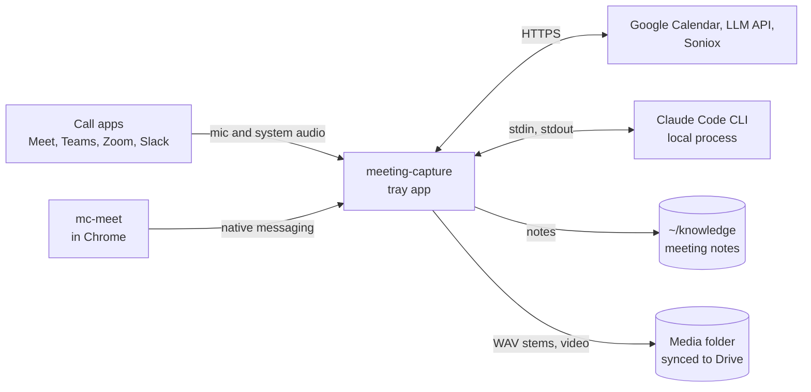
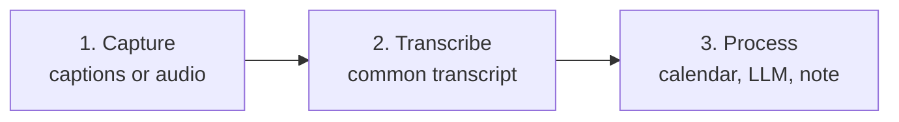
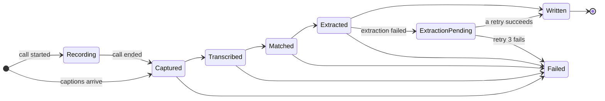
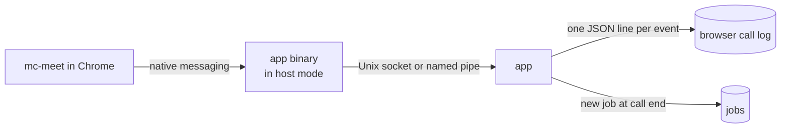
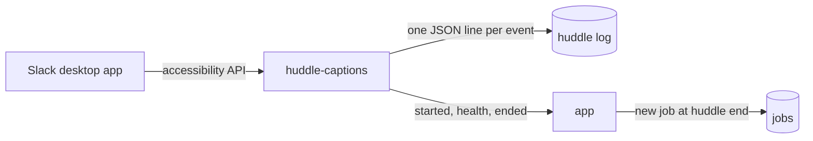
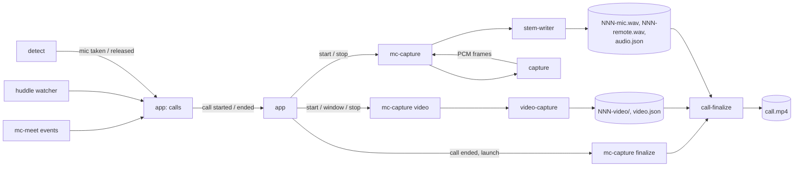
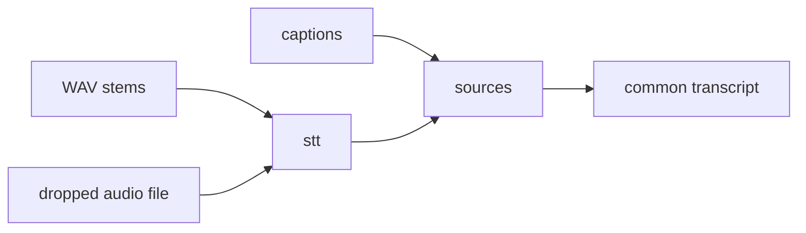
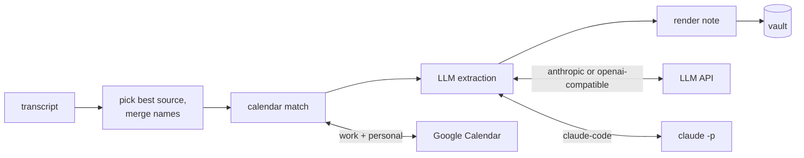
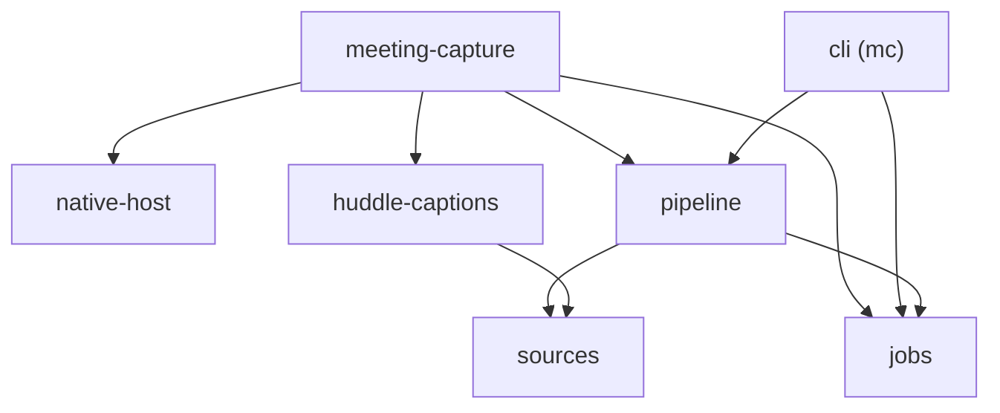

# Architecture

One Rust process: a Tauri 2 tray app. OS-specific code stays in two capture crates, the call
detector and the Slack huddle caption reader. Everything after "audio or captions exist" is shared
code that builds on both OSes.

The sections go from the outside in: what the app talks to, the three stages a meeting passes
through, then each stage on its own.

## Context



- Notes go to the vault. Audio and video go to the media folder, never the vault.
- `mc` is a second binary for reruns without the tray. It uses the same libraries.

## Stages

Every meeting is one row in the job store. It moves through three stages, and a crash resumes at
the last finished step.





A retry of a `Failed` job resumes at its last finished step. A failed extraction still writes the
note, with the transcript only. The meeting then shows `ExtractionPending` until a retry succeeds
or the third retry fails. [LLM extraction](07-llm-extraction.md) has the schedule.

The tray app and `mc` share the job store. A run holds a lease on its meeting, so one run per
meeting is active across both processes. The lease expires after 2 minutes, and a running pipeline
renews it every 30 s. The app runs every unfinished meeting at launch and every 5 minutes after, on
2 worker threads, so a meeting left by a crash or a quit finishes within minutes. Failed meetings
wait for a retry from the tray or `mc retry`. A new capture of the same meeting bumps its input
revision, and the run holding the lease starts over on the new input. The pipeline tells its own
writes from user edits by SHA-256, so Syncthing or git changing a file's time is not an edit. A
rerun over an edited note replaces only the sections between the app's `%% mc:begin %%` and
`%% mc:end %%` markers. When the user edited inside a section or broke a marker, the job fails and
names the note, and the tray offers "Overwrite my edits".

Captions from mc-meet and Slack huddles are already a transcript, so their job passes
`Transcribed` without running STT.

## 1. Capture

Two inputs, either or both per call.

### Meet captions (phase 1b)



- The extension reads captions, chat and the participant list from Meet's data channels, with a
  DOM fallback. It queues each event until the app acks it.
- Chrome starts the app binary in host mode, which relays frames to the running app and starts
  it when it is not running.
- The app appends each event to the call's log before the ack, so the log is complete before
  anything parses it. At call end it parses the log and records the meeting. A rejoin of the same
  meeting within 10 minutes goes into the same log.
- [mc-meet](09-meet-extension.md) has the protocol, the session rules and the install steps.

### Slack huddle captions (phase 1)



- `huddle-captions` polls Slack's huddle window every 0.5 s: caption rows, the caption overlay while
  the panel is hidden, participant tiles, the caption language. It writes the huddle log itself,
  so the log is complete before anything parses it.
- At huddle end the app parses the log and records the meeting. At launch it closes logs a crash
  left open and records any with no meeting.
- macOS only. On Windows the crate starts nothing until a UI Automation adapter exists.

### Call status

The app tracks each open Meet call and huddle in one status board
(`crates/app/src/call_status.rs`), and ticks it once a second.

- States: waiting (no caption since the call opened or resumed), recording, problem with a
  reason, stopped by the user, and ended with a caption count and length. A stopped call has no
  problem until the user resumes it. Each call keeps its start time, caption
  count, last caption time and its last 3 problems. A Meet call the app reopens after a restart
  counts the caption lines its log already holds.
- Reasons: captions off, Meet captions unavailable (Google), caption frames fail to decode, no
  caption for 2 minutes while captions are on, no caption for 2 minutes with the caption state
  unknown (a huddle with no health verdict yet), mc-meet disconnected, the Meet tab closed or
  reloaded, Slack huddle captions unreadable. A Meet call checks the reasons after 20 s without a
  caption, except a disconnect, which counts at once. Captions off counts until mc-meet reports
  its caption channels as the source: mc-meet hides Meet's captions only after a caption arrived
  on them, and they keep streaming.
- The tray icon is a grey dot when idle, red while recording and amber at a problem or a missing
  huddle permission. Audio that records turns an idle dot red. Audio that keeps failing, a call
  recording without the user's mic, or a refused microphone or system audio permission, turns
  it amber.
- On macOS only, each open call has an audio row. Each open call has "Stop recording this call".
  A stopped call shows "Resume recording" instead. The tooltip and the menu hold one status line
  per call, with times in the settings time zone. "Recent calls" lists the last 5 calls that
  ended in this run. The menu is rebuilt only when a call opens or ends; the status tick changes
  the text of its call lines in place, so an open menu stays open. On Windows the tooltip is cut
  to 127 UTF-16 units.
- Notifications: "Recording" once per call at its first caption. "Not recording" after a problem
  lasts 30 s, once per reason in one outage. "Recording again" at the first caption after it,
  which ends the outage, so a later outage is announced again. "No transcript captured" when a
  call ends with no caption. A Meet tab that closed or reloaded gets no "Not recording", since
  mc-meet ends the call in 5 minutes unless the tab comes back. "mc-meet disconnected" gets one
  only while another mc-meet port is connected: with none, the browser quit.
- mc-meet gets the status of its calls as `call_status` messages and shows it on its toolbar
  icon. At a Meet call's first problem the app writes the lead-up and asks for a page snapshot.
  [mc-meet](09-meet-extension.md) has the debug material and the debug report.

### Audio and video (phases 2, 3, 3b, 3c, 5)



- The app's `calls` module turns each source's reports into one call stream: `call.started`,
  `call.resumed` and `call.ended`, each with `call.id`, `call.platform` and `call.title`. The id is
  the source's log path. A Meet rejoin within 10 minutes resumes the same call. Capture subscribes
  to the stream.
- `detect` (phase 3b) reports when an app takes or releases the mic, and which app.
- `capture` has one `CallAudioSource` trait. Its macOS module uses a Core Audio global tap; its
  Windows module uses WASAPI process loopback. Both use `cpal` for the mic.
- `mc-capture` is a helper process the app spawns and restarts. It connects `capture` to
  `stem-writer`; neither crate knows about the other. A crash in capture never stops the tray.
- The app's `call_capture` module supervises `mc-capture audio` over JSON lines on stdin and
  stdout. The `capture-protocol` crate holds the line types. [Phase 3
  detail](03-roadmap.md#phase-3-detail) has the messages and the restart rules.
- Call folders live in the app data folder under `calls/`, one per call, named after the
  call log. They never go in the vault.
- `capture` and `stem-writer` both depend on `stem-timing`, which holds the types they share:
  `Stem`, `BufferStamp`, `StemLosses` and `UtcAnchor`.
- For a Slack huddle on the Mac, `call_capture` also runs `mc-capture video` with the huddle
  window's id, title and pid, on the same segment number. One stop control stops both. Video may
  fail alone while audio records on.
- Video records the window id the huddle watcher read, never a window found by title: Slack's
  main window shows private messages. The watcher sends the id only once the huddle's content
  shows in the window, since a conversation popped out into its own window looks the same before
  that. A huddle whose window id is unreadable gets no video. When the user reopens the huddle
  window, the watcher reports its new id and `call_capture` hands it to the running video
  process.
- A stop from the macOS sharing controls holds for the rest of the run: a wake or a new window
  starts no video until the call resumes.
- A quiet stream gets a stall check only when its last frame was complete. A still window, or a
  huddle with every camera off, sends one idle status and then nothing, so video cannot tell a
  stream that hangs after its idle status from a still one. Such a hang goes unnoticed until the
  window changes; rebuilding every quiet idle stream would cut still recordings instead.
- A stream stop that times out leaves a capture that may still run, so the video process closes
  the segment and exits, and `call_capture` restarts it.
- Video follows the audio helper across a sleep: the audio's sleep report stops the video segment,
  and its wake starts the next on the audio's wake segment. A video restart takes video's next
  free number, so each video segment records the `audio_segment` it pairs with.
- `video-capture` records that one window through ScreenCaptureKit at up to 1280x720 and 15 fps,
  even while other windows cover it. VideoToolbox encodes HEVC in hardware, and AVAssetWriter cuts
  2 s HLS fragments into `NNN-video/`. Each fragment is fsynced, then listed in `index.m3u8` and
  `video.json`. Meet video comes from tab capture instead.
- Each capture process keeps its own manifest in the call folder: `audio.json` from the audio
  process, `video.json` from the video process. Finalize reads both.
- Audio repair lives in `stem-writer` and video repair in `video-capture`, each beside the
  writer it must match. The app runs both over `calls/` at launch. Video repair ends each open
  playlist with `#EXT-X-ENDLIST`, keeps listed fragments and drops unlisted partial ones. Each
  segment start runs its process's repair on its own folder. `mc-capture repair --folder` runs
  both by hand.
- `call-folder` holds what every capture process shares about a call folder: the OS file lock
  that marks a live writer (`audio.lock`, `video.lock`) and the walk over `calls/`.
- Finalize writes `call.mp4` in the call folder: the video segments as one track, and the mic
  and remote stems mixed into one 16 kHz mono AAC track at 48 kbps. The file has no faststart:
  its index sits at the end, so it plays from disk but not progressively over a network. The
  stems and fragments stay.
- When a call that recorded ends, `call_capture` runs `mc-capture finalize --folder` once the
  call's processes have stopped. At launch, after repair, it runs `mc-capture pending-finalize
  --calls-dir` for the list of folders to finalize, then one `finalize --folder` per folder,
  killed after 20 minutes. A folder a capture process still holds gets one more try 30 s later.
  The app links no AVFoundation.
- Finalize first sweeps what a killed run left, then repairs the folder, and skips it while a
  capture process holds a lock. Its own `finalize.lock` keeps two runs apart; a second run waits
  up to 5 minutes for it. It writes `.call.partial.mp4`, then renames it.
- `finalize.json` in the call folder records the size and modified time of both manifests a run
  read, and how the run ended: written, no video, failed, or started and never finished. A
  folder is pending when a manifest changed since, or `call.mp4` is gone. A failed or killed run
  is retried once at the next launch on the same manifests, then left. Any error after the lock
  that leaves a manifest readable is recorded as failed.
- Offsets come from the call timeline, in UTC nanoseconds. A video part starts at its first
  frame's host time, read through the clock reading of the audio segment it pairs with, or its
  own when no audio pairs. Segments whose readings agree on UTC minus host time within 500 ms
  share the first one, so their host time spacing stays exact; a sleep or a reboot starts a new
  run. The earliest part or stem sample is 0 s.
- Each stem is placed in 1 s chunks, each at its own host time, cut where a run ahead starts
  and ends, and in 10 ms chunks inside it. Where a run ahead starts, the file holds audio twice
  for one span of host time, and the later copy loses its head. A steering hole of up to 1 ms is
  filled from the file. The summed stems pass a soft limiter above 80% of full scale.
- A browser part (Meet tab capture, code only) starts at its first frame's UTC instead, and its
  paired remote stem moves earlier by the playback latency the browser logged.
- A part whose start falls at or before the previous part's last frame moves whole to one frame
  after it, so video times only rise and its key frame stays. Between segments the video holds
  its last frame and the mix is silent. Open segments and segments with no clock or no samples
  are skipped and listed in the outcome.
- All parts go into one video track in the first part's codec and size. A part that matches is
  copied as it is. A part with another codec or size is decoded, letterboxed into that size with
  black bars, and encoded again in hardware with the capture's settings: 700 kbps and a keyframe
  every 2 s. AVFoundation shows a resized part stretched in a shared passthrough track, and
  refuses an H.264 part after HEVC.

## 2. Transcribe (phases 4, 6)



- `stt` runs VAD, Parakeet TDT 0.6B v3 and diarization of the remote stem, locally.
- Hinglish calls go to Soniox instead of Parakeet.
- `sources` turns every input into the common transcript format below.

## 3. Process (phase 1)



- All of this is the `pipeline` crate. It has no Tauri dependency, so `mc reprocess` runs it too.
- Calendar match takes the event with the same Meet code, else the largest time overlap, across
  both accounts. Slack huddles are never matched.
- Extraction asks the LLM for notes in which every item cites transcript lines, then checks each
  quote against the transcript. [LLM extraction](07-llm-extraction.md) covers the prompt,
  providers, retries and note sections.
- If extraction fails, the note is still written with the transcript and the tag
  `status/needs-extraction`. The job retries after 5 minutes, 30 minutes and 2 hours.
- LLM settings apply to the next run without a restart. The pipeline reads them per run.
- `pipeline` also owns the settings file. The app and `mc` load settings through it, so both read
  the same TOML with the same validation.

## Crate dependencies

Each arrow is a Cargo dependency. Phase 1 crates:



Later crates attach in their phase: the app depends on `detect`, `capture-protocol`,
`stem-writer` and `video-capture`; `mc-capture` on `capture`, `stem-writer`, `video-capture` and
`call-finalize`;
`sources` depends on `stt`.

- The two binaries own the wiring. Library crates never depend on `meeting-capture` or `cli`.
- Only `meeting-capture` depends on Tauri.

## Components

| Component | Phase | Job | Built on |
|---|---|---|---|
| native-host | 1b | Host mode for Chrome native messaging, the app socket, frame codecs, host manifest registration | `tokio`; adapted from Anarlog `crates/chrome-native-host` |
| huddle-captions | 1 | Read Slack huddle captions from the Slack desktop app, write the huddle log, report health | Mac: accessibility API via `objc2-application-services` |
| sources | 1 | Turn each input into the common transcript format. Provide the append-only log both call log writers use | Captions, own stems, dropped audio files |
| pipeline | 1 | Pick the best source, merge names, calendar match, Soniox for Hinglish, LLM extraction and quote check, vault write and splice, settings file | `rig-core`, `rig-agent`, `schemars`, `oauth2`, `reqwest`, `minijinja`, `toml`, `directories` |
| jobs | 1 | One row per meeting with a closed state enum and the extraction retry schedule. Runs a meeting's steps under its lease: one run per meeting across processes, renewed from a second thread, given back however the run ends | `rusqlite`, `tracing` |
| cli | 1 | `mc`: rerun any job step or ingest a file, without Tauri | `clap` |
| app | 1 | Tray, call status, debug reports, settings, notifications, permission prompts, review of extracted commitments | Tauri 2, plugin `notification` 2 |
| detect | 3b | Emit "call started" and "call ended" when an app takes or releases the mic | Vendored from Anarlog `crates/detect` (MIT) |
| capture | 3, 5 | One `CallAudioSource` trait; per-OS adapters emit timestamped PCM frames | Mac: Core Audio tap via `cidre`. Windows: WASAPI process loopback via `wasapi`. Mic: `cpal`. Adapted from Anarlog `crates/audio-actual` |
| stem-timing | 3 | The types `capture` and `stem-writer` share: stem, buffer stamp, ring losses, clock reading. Portable, no audio API | `serde` |
| call-folder | 3 | The per-process lock on a call folder and the walk over `calls/`, shared by every capture process and repair | std file locks |
| stem-writer | 3 | Write mic and remote stems as 16 kHz mono WAV placed by host time, fsynced every 4.5 s, and `audio.json` | `rubato` |
| call-finalize | 3c | Place a call's video parts and stems on one timeline, mix the stems, write `call.mp4`. The planning and mixing are portable | Mac: AVFoundation via `cidre` |
| stt | 4 | VAD, Parakeet TDT 0.6B v3 int8, diarization of the remote stem | `sherpa-onnx` |
| video-capture | 3c | Record one window through ScreenCaptureKit, encode it with VideoToolbox, cut 2 s HLS fragments with AVAssetWriter, write `video.json`, repair dead segments. The writer and repair are portable | Mac: `cidre` |

## Design rules

- OS code lives only in the capture adapters, `video-capture`, `call-finalize`, the detector and
  `huddle-captions`. Each of them may use unsafe code for its FFI; the workspace forbids it
  everywhere else.
- The pipeline has no Tauri dependency. A CLI can rerun any meeting from its stored inputs.
- Notes are written to a temp file outside the vault, then renamed into place. Syncthing never sees
  a half-written note.
- Media never goes into the vault.
- Transcript text and model output are data. The note escapes both, so neither can add Markdown
  structure, wikilinks or section markers.
- Secrets live in `settings.toml`: Google refresh tokens, the OAuth client secret, the LLM API key.
  The file is owner-only and stays out of the vault and git.
- Stored times are UTC.

## Common transcript format

Every source produces this shape before the pipeline runs:

```yaml
source: transcriptonic | slack-huddle | meet-extension | recorder | meet-api | audio-file
started_at: 2026-10-16T05:30:00Z
ended_at: 2026-10-16T06:10:00Z
platform: meet | teams | zoom | slack | other
meeting_url: https://meet.google.com/abc-defg-hij
title: Weekly sync            # what the call app showed; null if none
speaker_naming: real | me-vs-them | diarized
my_speaker: You               # the label the local user's lines carry; null if unknown
attendees:                    # people who joined; empty for TranscripTonic
  - {name: "Ujjwal Kumar", is_self: true, platform_id: U0123ABCDEF}
segments:
  - {start_s: 0.0, end_s: 4.2, speaker: "Ujjwal", text: "..."}
chat_messages:
  - {sent_at: 2026-10-16T05:31:00Z, sender: "Ujjwal", text: "..."}
```

- `start_s` and `end_s` are seconds from `started_at`.
- mc-meet captions start when an utterance first appears and end at its last update.
- TranscripTonic payloads, from earlier versions, record only when a caption block starts. A block
  ends where the next one starts, and the last one ends at `ended_at`.

## Platform notes

- **macOS:** needs the Microphone and System Audio Recording permissions, which Core Audio taps
  require (macOS 14.4 or later). Sign builds with a self-signed certificate. An ad-hoc signature
  changes every build and macOS then drops the permissions.
- **Windows:** WASAPI process loopback with the process-tree mode covers Chrome's separate audio
  process. An unsigned installer is fine for personal use.
