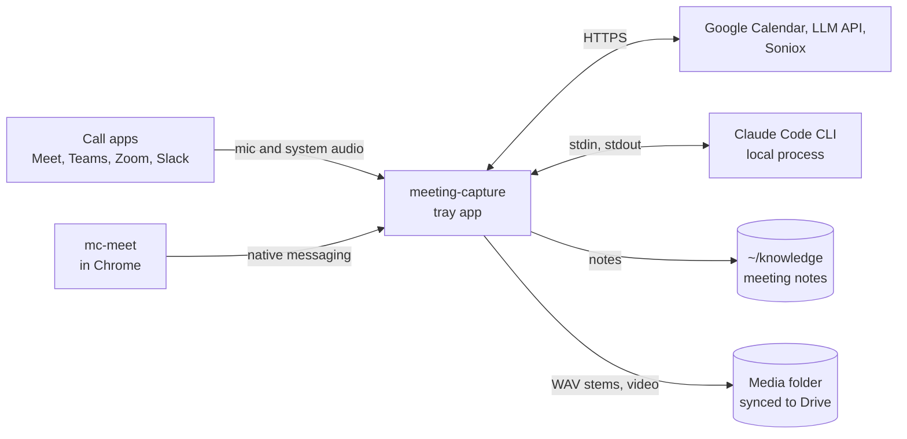
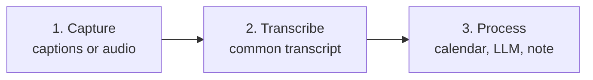
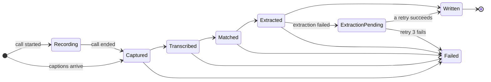
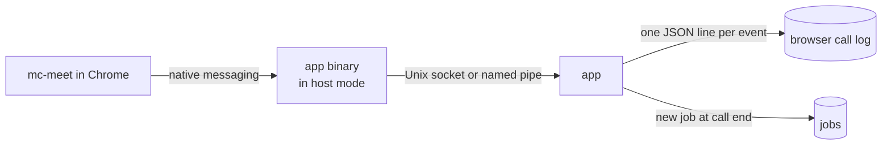
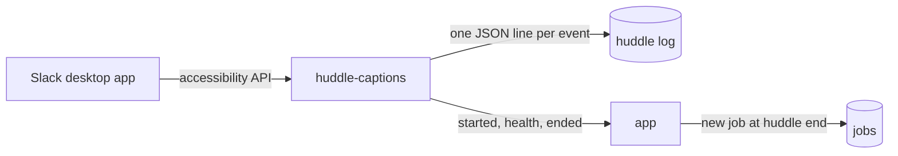
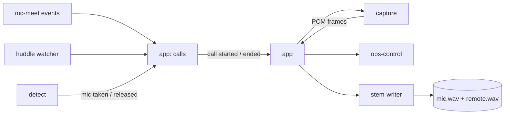
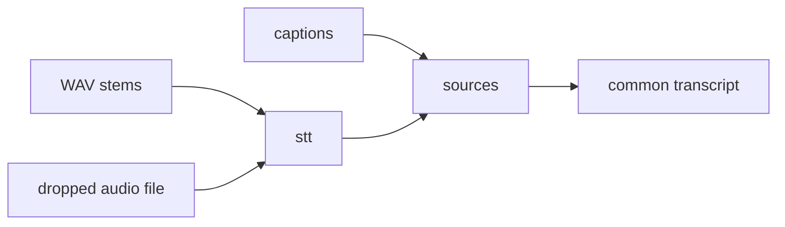
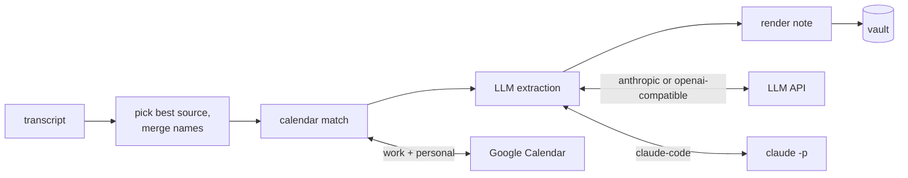
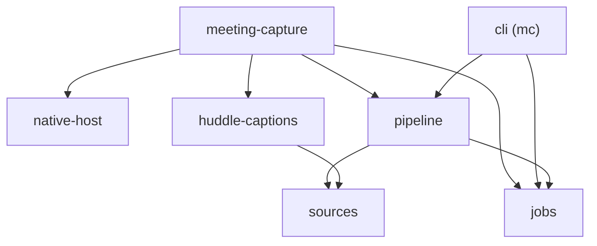

# Architecture

One Rust process: a Tauri 2 tray app. OS-specific code stays in two capture crates, the call
detector and the Slack huddle caption reader. Everything after "audio or captions exist" is shared
code that builds on both OSes.

The sections go from the outside in: what the app talks to, the three stages a meeting passes
through, then each stage on its own.

## Context



- Notes go to the vault. Audio and video go to the media folder, never the vault.
- `mc` is a second binary for reruns without the tray. It uses the same libraries.

## Stages

Every meeting is one row in the job store. It moves through three stages, and a crash resumes at
the last finished step.





A retry of a `Failed` job resumes at its last finished step. A failed extraction still writes the
note, with the transcript only. The meeting then shows `ExtractionPending` until a retry succeeds
or the third retry fails. [LLM extraction](07-llm-extraction.md) has the schedule.

The tray app and `mc` share the job store. A run holds a lease on its meeting, so one run per
meeting is active across both processes. The lease expires after 2 minutes, and a running pipeline
renews it every 30 s. The app runs every unfinished meeting at launch and every 5 minutes after, on
2 worker threads, so a meeting left by a crash or a quit finishes within minutes. Failed meetings
wait for a retry from the tray or `mc retry`. A new capture of the same meeting bumps its input
revision, and the run holding the lease starts over on the new input. The pipeline tells its own
writes from user edits by SHA-256, so Syncthing or git changing a file's time is not an edit. A
rerun over an edited note replaces only the sections between the app's `%% mc:begin %%` and
`%% mc:end %%` markers. When the user edited inside a section or broke a marker, the job fails and
names the note, and the tray offers "Overwrite my edits".

Captions from mc-meet and Slack huddles are already a transcript, so their job passes
`Transcribed` without running STT.

## 1. Capture

Two inputs, either or both per call.

### Meet captions (phase 1b)



- The extension reads captions, chat and the participant list from Meet's data channels, with a
  DOM fallback. It queues each event until the app acks it.
- Chrome starts the app binary in host mode, which relays frames to the running app and starts
  it when it is not running.
- The app appends each event to the call's log before the ack, so the log is complete before
  anything parses it. At call end it parses the log and records the meeting. A rejoin of the same
  meeting within 10 minutes goes into the same log.
- [mc-meet](09-meet-extension.md) has the protocol, the session rules and the install steps.

### Slack huddle captions (phase 1)



- `huddle-captions` polls Slack's huddle window every 0.5 s: caption rows, the caption overlay while
  the panel is hidden, participant tiles, the caption language. It writes the huddle log itself,
  so the log is complete before anything parses it.
- At huddle end the app parses the log and records the meeting. At launch it closes logs a crash
  left open and records any with no meeting.
- macOS only. On Windows the crate starts nothing until a UI Automation adapter exists.

### Audio (phases 2, 3, 3b, 5, 7)



- The app's `calls` module turns each source's reports into one call stream: `call.started`,
  `call.resumed` and `call.ended`, each with `call.id`, `call.platform` and `call.title`. The id is
  the source's log path. A Meet rejoin within 10 minutes resumes the same call. Capture subscribes
  to the stream.
- `detect` (phase 3b) reports when an app takes or releases the mic, and which app.
- `capture` has one `CallAudioSource` trait. The macOS build uses a Core Audio tap; the Windows
  build uses WASAPI process loopback. Both use `cpal` for the mic.
- The app connects `capture` to `stem-writer`. Neither crate knows about the other.
- `obs-control` starts and stops OBS video recording with the call.

## 2. Transcribe (phases 4, 6)



- `stt` runs VAD, Parakeet TDT 0.6B v3 and diarization of the remote stem, locally.
- Hinglish calls go to Soniox instead of Parakeet.
- `sources` turns every input into the common transcript format below.

## 3. Process (phase 1)



- All of this is the `pipeline` crate. It has no Tauri dependency, so `mc reprocess` runs it too.
- Calendar match takes the event with the same Meet code, else the largest time overlap, across
  both accounts. Slack huddles are never matched.
- Extraction asks the LLM for notes in which every item cites transcript lines, then checks each
  quote against the transcript. [LLM extraction](07-llm-extraction.md) covers the prompt,
  providers, retries and note sections.
- If extraction fails, the note is still written with the transcript and the tag
  `status/needs-extraction`. The job retries after 5 minutes, 30 minutes and 2 hours.
- LLM settings apply to the next run without a restart. The pipeline reads them per run.
- `pipeline` also owns the settings file. The app and `mc` load settings through it, so both read
  the same TOML with the same validation.

## Crate dependencies

Each arrow is a Cargo dependency. Phase 1 crates:



Later crates attach in their phase: the app depends on `detect`, `capture`, `stem-writer` and
`obs-control`; `sources` depends on `stt`.

- The two binaries own the wiring. Library crates never depend on `meeting-capture` or `cli`.
- Only `meeting-capture` depends on Tauri.

## Components

| Component | Phase | Job | Built on |
|---|---|---|---|
| native-host | 1b | Host mode for Chrome native messaging, the app socket, frame codecs, host manifest registration | `tokio`; adapted from Anarlog `crates/chrome-native-host` |
| huddle-captions | 1 | Read Slack huddle captions from the Slack desktop app, write the huddle log, report health | Mac: accessibility API via `objc2-application-services` |
| sources | 1 | Turn each input into the common transcript format. Provide the append-only log both call log writers use | Captions, own stems, dropped audio files |
| pipeline | 1 | Pick the best source, merge names, calendar match, Soniox for Hinglish, LLM extraction and quote check, vault write and splice, settings file | `rig-core`, `rig-agent`, `schemars`, `oauth2`, `reqwest`, `minijinja`, `toml`, `directories` |
| jobs | 1 | One row per meeting with a closed state enum and the extraction retry schedule. Runs a meeting's steps under its lease: one run per meeting across processes, renewed from a second thread, given back however the run ends | `rusqlite`, `tracing` |
| cli | 1 | `mc`: rerun any job step or ingest a file, without Tauri | `clap` |
| app | 1 | Tray, settings, "Note written" notifications, permission prompts, review of extracted commitments | Tauri 2, plugin `notification` 2 |
| detect | 3b | Emit "call started" and "call ended" when an app takes or releases the mic | Vendored from Anarlog `crates/detect` (MIT) |
| capture | 3, 5 | One `CallAudioSource` trait; per-OS adapters emit timestamped PCM frames | Mac: Core Audio tap via `cidre`. Windows: WASAPI process loopback via `wasapi`. Mic: `cpal`. Adapted from Anarlog `crates/audio-actual` |
| stem-writer | 3 | Write mic and remote stems as 16 kHz mono WAV, flushed every few seconds | `hound` |
| stt | 4 | VAD, Parakeet TDT 0.6B v3 int8, diarization of the remote stem | `sherpa-onnx` |
| obs-control | 7 | Start and stop OBS video recording with the call | `obws` |

## Design rules

- OS code lives only in the capture adapters, the detector and `huddle-captions`. Each of them may
  use unsafe code for its FFI; the workspace forbids it everywhere else.
- The pipeline has no Tauri dependency. A CLI can rerun any meeting from its stored inputs.
- Notes are written to a temp file outside the vault, then renamed into place. Syncthing never sees
  a half-written note.
- Media never goes into the vault.
- Transcript text and model output are data. The note escapes both, so neither can add Markdown
  structure, wikilinks or section markers.
- Secrets live in `settings.toml`: Google refresh tokens, the OAuth client secret, the LLM API key.
  The file is owner-only and stays out of the vault and git.
- Stored times are UTC.

## Common transcript format

Every source produces this shape before the pipeline runs:

```yaml
source: transcriptonic | slack-huddle | meet-extension | recorder | meet-api | audio-file
started_at: 2026-10-16T05:30:00Z
ended_at: 2026-10-16T06:10:00Z
platform: meet | teams | zoom | slack | other
meeting_url: https://meet.google.com/abc-defg-hij
title: Weekly sync            # what the call app showed; null if none
speaker_naming: real | me-vs-them | diarized
my_speaker: You               # the label the local user's lines carry; null if unknown
attendees:                    # people who joined; empty for TranscripTonic
  - {name: "Ujjwal Kumar", is_self: true, platform_id: U0123ABCDEF}
segments:
  - {start_s: 0.0, end_s: 4.2, speaker: "Ujjwal", text: "..."}
chat_messages:
  - {sent_at: 2026-10-16T05:31:00Z, sender: "Ujjwal", text: "..."}
```

- `start_s` and `end_s` are seconds from `started_at`.
- mc-meet captions start when an utterance first appears and end at its last update.
- TranscripTonic payloads, from earlier versions, record only when a caption block starts. A block
  ends where the next one starts, and the last one ends at `ended_at`.

## Platform notes

- **macOS:** needs the Microphone and System Audio Recording permissions, which Core Audio taps
  require (macOS 14.4 or later). Sign builds with a self-signed certificate. An ad-hoc signature
  changes every build and macOS then drops the permissions.
- **Windows:** WASAPI process loopback with the process-tree mode covers Chrome's separate audio
  process. An unsigned installer is fine for personal use.
