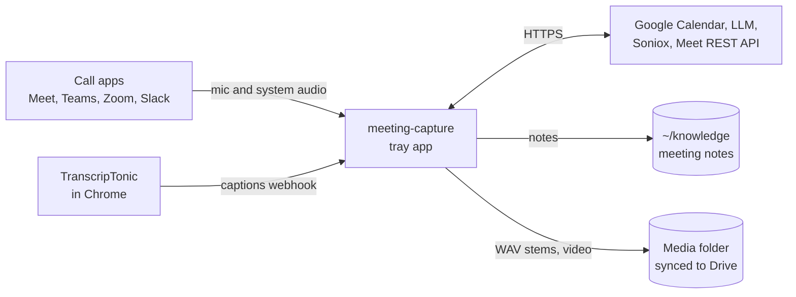
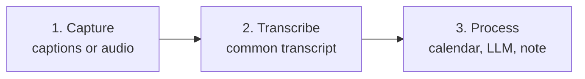
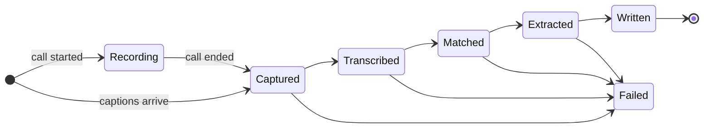
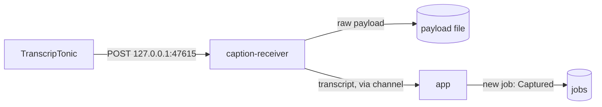
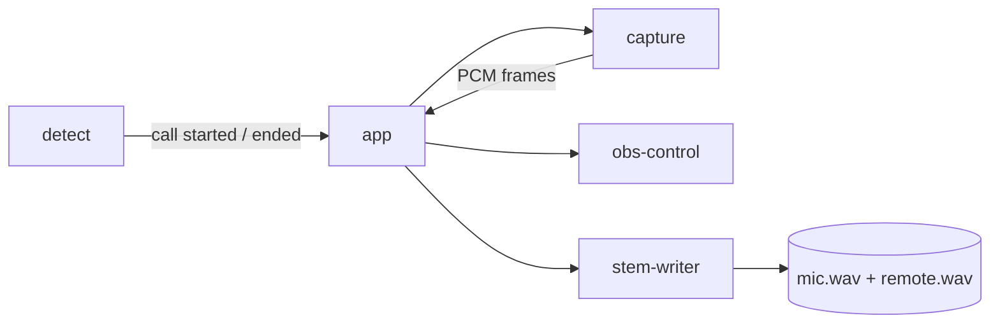
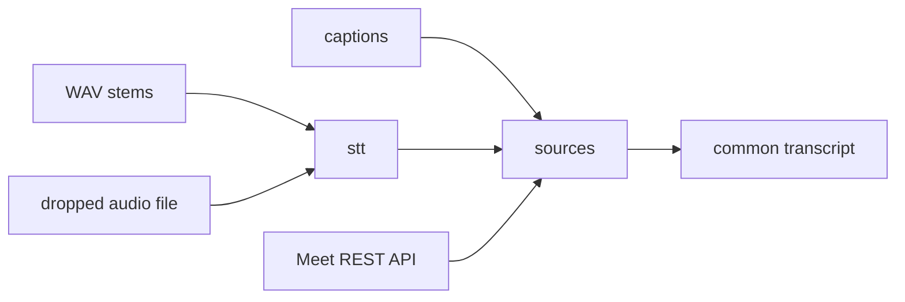
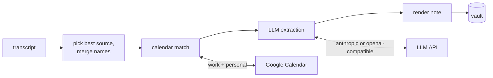
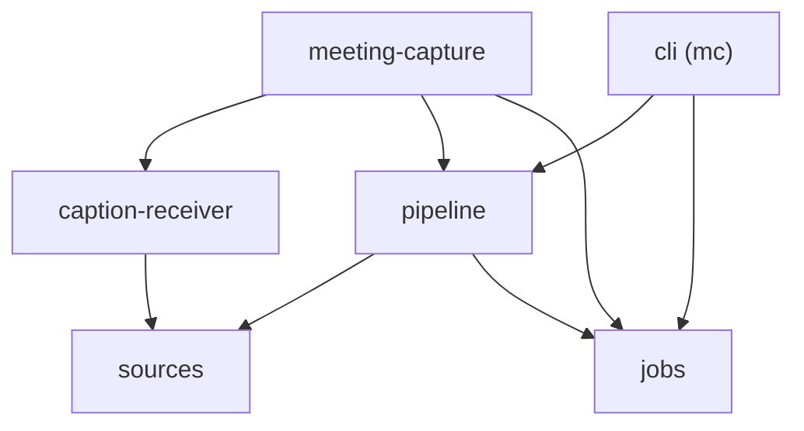

# Architecture

One Rust process: a Tauri 2 tray app. OS-specific code stays in two capture crates and the call
detector. Everything after "audio or captions exist" is shared code that builds on both OSes.

The sections go from the outside in: what the app talks to, the three stages a meeting passes
through, then each stage on its own.

## Context



- Notes go to the vault. Audio and video go to the media folder, never the vault.
- `mc` is a second binary for reruns without the tray. It uses the same libraries.

## Stages

Every meeting is one row in the job store. It moves through three stages, and a crash resumes at
the last finished step.





A retry of a `Failed` job resumes at its last finished step.

The tray app and `mc` share the job store. A run holds a lease on its meeting, so one run per
meeting is active across both processes. A new capture of the same meeting bumps its input
revision, and the run holding the lease starts over on the new input. A note edited after its
last write is never overwritten; the job fails and names the note. The pipeline tells its own
writes from user edits by SHA-256, so Syncthing or git changing a file's time is not an edit.

Captions from TranscripTonic are already a transcript, so their job passes `Transcribed` without
running STT.

## 1. Capture

Two inputs, either or both per call.

### Captions (phase 1)



- `caption-receiver` saves the raw payload before parsing, so a parser bug never loses a meeting.
  The payload is synced to disk under a unique name before the reply, because TranscripTonic never
  re-posts a meeting it saw succeed.
- Any web page in the browser can POST to 127.0.0.1. The receiver rejects a request whose `Origin`
  is not TranscripTonic's extension, whose `Host` is not the receiver, or whose body is not
  `application/json`. Local tools such as curl send no `Origin` and pass.
- It parses the payload into a `sources` transcript and hands it to the app. It does not touch the
  job store.

### Audio (phases 2, 3, 5, 7)



- `detect` reports when an app takes or releases the mic, and which app.
- `capture` has one `CallAudioSource` trait. The macOS build uses a Core Audio tap; the Windows
  build uses WASAPI process loopback. Both use `cpal` for the mic.
- The app connects `capture` to `stem-writer`. Neither crate knows about the other.
- `obs-control` starts and stops OBS video recording with the call.

## 2. Transcribe (phases 4, 6)



- `stt` runs VAD, Parakeet TDT 0.6B v3 and diarization of the remote stem, locally.
- Hinglish calls go to Soniox instead of Parakeet.
- `sources` turns every input into the common transcript format below.

## 3. Process (phase 1)



- All of this is the `pipeline` crate. It has no Tauri dependency, so `mc reprocess` runs it too.
- Calendar match takes the event with the largest time overlap across both accounts.
- If extraction fails, the note is still written with the transcript and the tag
  `status/needs-extraction`, and the job retries later.
- `pipeline` also owns the settings file. The app and `mc` load settings through it, so both read
  the same TOML with the same validation.

## Crate dependencies

Each arrow is a Cargo dependency. Phase 1 crates:



Later crates attach in their phase: the app depends on `detect`, `capture`, `stem-writer` and
`obs-control`; `sources` depends on `stt`.

- The two binaries own the wiring. Library crates never depend on `meeting-capture` or `cli`.
- Only `meeting-capture` depends on Tauri.

## Components

| Component | Phase | Job | Built on |
|---|---|---|---|
| caption-receiver | 1 | Accept TranscripTonic's webhook; fallback watches Downloads for its `.txt` | `axum` |
| sources | 1 | Turn each input into the common transcript format | Captions, own stems, Meet REST API, dropped audio files |
| pipeline | 1 | Pick the best source, merge names, calendar match, Soniox for Hinglish, LLM extraction, vault write, settings file | `rig-core`, `schemars`, `garde`, `yup-oauth2`, `google-calendar3`, `keyring`, `minijinja`, `toml`, `directories` |
| jobs | 1 | One row per meeting with a closed state enum and retry count | `rusqlite` |
| cli | 1 | `mc`: rerun any job step or ingest a file, without Tauri | `clap` |
| app | 1 | Tray, settings, permission prompts, review of extracted commitments | Tauri 2 |
| detect | 2 | Emit "call started" and "call ended" when an app takes or releases the mic | Vendored from Anarlog `crates/detect` (MIT) |
| capture | 3, 5 | One `CallAudioSource` trait; per-OS adapters emit timestamped PCM frames | Mac: Core Audio tap via `cidre`. Windows: WASAPI process loopback via `wasapi`. Mic: `cpal`. Adapted from Anarlog `crates/audio-actual` |
| stem-writer | 3 | Write mic and remote stems as 16 kHz mono WAV, flushed every few seconds | `hound` |
| stt | 4 | VAD, Parakeet TDT 0.6B v3 int8, diarization of the remote stem | `sherpa-onnx` |
| obs-control | 7 | Start and stop OBS video recording with the call | `obws` |

## Design rules

- OS code lives only in the capture adapters and the detector.
- The pipeline has no Tauri dependency. A CLI can rerun any meeting from its stored inputs.
- Notes are written to a temp file outside the vault, then renamed into place. Syncthing never sees
  a half-written note.
- Media never goes into the vault.
- Stored times are UTC.

## Common transcript format

Every source produces this shape before the pipeline runs:

```yaml
source: transcriptonic | recorder | meet-api | audio-file
started_at: 2026-10-16T05:30:00Z
ended_at: 2026-10-16T06:10:00Z
platform: meet | teams | zoom | other
meeting_url: https://meet.google.com/abc-defg-hij
title: Weekly sync            # what the call app showed; null if none
speaker_naming: real | me-vs-them | diarized
segments:
  - {start_s: 0.0, end_s: 4.2, speaker: "Ujjwal", text: "..."}
chat_messages:
  - {sent_at: 2026-10-16T05:31:00Z, sender: "Ujjwal", text: "..."}
```

- `start_s` and `end_s` are seconds from `started_at`.
- TranscripTonic records only when a caption block starts. A block ends where the next one starts,
  and the last one ends at `ended_at`.
- TranscripTonic posts to `http://127.0.0.1:47615/transcriptonic`. A simple body is rejected with
  HTTP 422; only the advanced body carries ISO times and per-speaker blocks.

## Platform notes

- **macOS:** needs the Microphone and System Audio Recording permissions, which Core Audio taps
  require (macOS 14.4 or later). Sign builds with a self-signed certificate. An ad-hoc signature
  changes every build and macOS then drops the permissions.
- **Windows:** WASAPI process loopback with the process-tree mode covers Chrome's separate audio
  process. An unsigned installer is fine for personal use.
