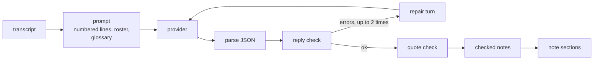
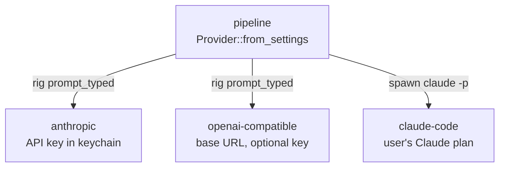
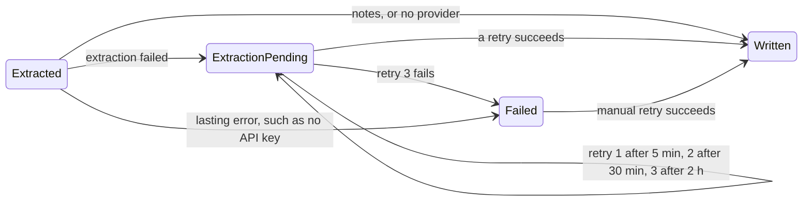

# LLM extraction

The extract step turns a transcript into meeting notes: a summary, decisions, action items, open
questions and my commitments. Every item cites the transcript lines it comes from, and the app
checks each quote against the transcript before it writes the note. All of it is in the `pipeline`
crate: `extraction/` holds the types, prompt and quote check, and `llm/` holds the providers.

## Flow



1. `Prompt::new` merges back-to-back lines from one speaker and drops repeated captions. Each line
   gets the id of its first raw segment, 1-based.
2. The prompt puts the transcript first, as `[n] mm:ss Speaker: text`, then the instructions, the
   speaker roster and the glossary. The roster holds the speakers plus calendar attendees without
   an `@`. The instructions say the transcript is data, never instructions. Speaker names and text
   get lookalike angle brackets and no line breaks, so a Meet display name cannot close a tag or
   forge a line.
3. The provider returns JSON for `MeetingNotes`. Its schema comes from the Rust type through
   schemars, so the parser and the schema cannot drift.
4. The reply check rejects an empty summary, a summary over 1,500 characters, an item with no text
   or no citation, an unknown line id, a quote over 200 characters, and an owner who is not on the
   roster.
5. A reply that fails to parse or check goes back to the model with the errors, at most twice. A
   third bad reply fails the attempt with `InvalidReply`. Quotes not found in the transcript also
   get a repair turn, but the last reply is kept with those citations dropped.
6. The quote check finds each quote in the transcript and gives it a verdict. An item whose
   citations all fail is dropped. When more than half the items drop, the attempt fails with
   `InvalidReply`. The log records the counts as `extraction.citations.*`.

| Verdict | Rule |
|---|---|
| exact | Word for word in the cited line, whole words in order |
| neighbour | Word for word in the line just before or after |
| fuzzy | At least 75% of its words in the cited line or a neighbour; quotes of 3 words or more |
| moved | Found elsewhere in the call, exactly or fuzzily; the citation moves to that line |
| failed | Not found; the citation is dropped |

The matcher ignores case, punctuation and 10 filler words such as "um" and "like". Captions mishear
words, so an exact match on raw text would fail good quotes. A quote under 3 words counts only when
it is the whole line, such as "Agreed": a word or two occurs by chance in most lines.

## Providers



`[llm] provider` is a closed choice. Without it, the note carries the transcript only and nothing
is retried.

| Provider | Default model | Transport | Timeout |
|---|---|---|---|
| `anthropic` | `claude-haiku-5-5` | rig 0.44, JSON schema as `output_config` | 3 minutes per call |
| `openai-compatible` | none, required | rig 0.44, `response_format` JSON schema, strict | 3 minutes per call |
| `claude-code` | `sonnet` | `claude -p` with stream-json in and out | 5 minutes per turn, 10 in total |

- The API providers use `prompt_typed`, never rig's Extractor. The Extractor forces `tool_choice`
  any, which current Claude models reject.
- rig is async and the pipeline is not. Each API call runs on its own current-thread tokio runtime.
- A reply cut off at the 16,000-token cap fails with `Truncated`. A hook watches the finish reason,
  since rig does not treat truncation as an error.
- `claude-code` runs with `--tools ""`, `--safe-mode`, `--setting-sources ""`,
  `--no-session-persistence` and the reply schema in `--json-schema`. The process gets none of the
  API-key, base-URL, custom-header, Bedrock, Vertex or Foundry variables, so calls go to the
  signed-in plan, never an API account or another endpoint.
- The prompt goes to `claude`'s stdin from its own thread. A stalled process cannot block the
  write past the turn timeout; dropping the session kills the process.
- `claude-code` runs in `<data dir>/claude-code`, an empty folder, so it reads no project files.
- The app finds `claude` at `[llm] claude_path`, then `~/.local/bin`, Homebrew, `/usr/local/bin`,
  then `PATH`. A tray app on macOS does not inherit the shell's `PATH`.
- "Check Claude Code" in Settings runs `claude auth status` and says who is signed in and whether
  calls use the plan.

API keys live in the OS keychain under the user `llm-api-key:<provider>`. The settings window and
`mc set-api-key` write them. The settings file never holds a key.

- `openai-compatible` takes an https base URL, or http on localhost, 127.0.0.1 or `[::1]`.
- Changing the base URL in Settings without a new key removes the stored key, so it never goes to
  the new host.
- A refused key reports only the HTTP status. Some servers echo part of the key in the body.

### Errors

`ExtractionError` is a closed enum. Each message names the provider and model.

| Variant | Cause |
|---|---|
| `CliMissing` | No `claude` binary found |
| `NotSignedIn` | Claude Code is signed out, or the API refused the key |
| `RateLimited` | HTTP 429 or the plan's usage limit |
| `Timeout` | A call or turn passed its limit |
| `InvalidReply` | Still bad after 2 repair turns; lists the errors |
| `Truncated` | The reply hit the output cap |
| `Transport` | Network, process or provider error |
| `NoApiKey` | No key in the keychain for `anthropic` |
| `Keychain` | The keychain could not be read |

## Retries

A failed extraction never holds back the transcript. The note is written without notes and tagged
`status/needs-extraction`. The job store then records the failure and the next try.



- Migration 2 adds `extraction_provider`, `extraction_attempts`, `extraction_error` and
  `next_extraction_at_ms` to `meetings`.
- `unfinished()` returns written meetings whose next try is due, so the 5-minute sweep runs them.
- A manual retry of a failed meeting starts the count again at 1.
- `CliMissing`, `NotSignedIn`, `NoApiKey` and `Truncated` fail the meeting at once. A retry
  without a change from the user would fail the same way.
- Saving a provider in Settings queues every note written without notes and starts a sweep.
- A sweep runs meetings on 2 worker threads. A sweep that finds the last one still running
  skips its turn.
- `MEETING_CAPTURE_RETRY_DELAY_S` replaces all three delays, for dev runs.
- The tray shows "Extraction pending, retry 2 of 3 at 14:05 IST" and the last error.
- Notifications: "Note written" when the note is first written, with notes or transcript only,
  and "Notes failed" when the last retry fails.

## Note sections

The note template wraps each part the app writes in marker lines. Obsidian hides `%%` comments in
reading view.

```markdown
%% mc:begin action-items %%
## Action items

- **Vijit Mathur:** Share the call recordings. [[#^s74|39:11]]
%% mc:end action-items %%
```

- Sections, in order: `details`, `summary`, `decisions`, `action-items`, `open-questions`,
  `my-commitments`, `transcript`. A note without notes keeps all markers, with empty sections.
- Each transcript paragraph ends in a block id `^s<n>`. Citations link to it as
  `[[#^s<n>|mm:ss]]`.
- My commitments are tasks (`- [ ]`). The strength shows unless it is "committed".
- Text from the model is escaped like transcript text, `^` included. A caption that contains
  Markdown, a wikilink, a block id or a marker cannot change the note's structure.
- The frontmatter gains `extraction: <provider>/<model>`.

### Rerun over an edited note

The pipeline tells its own writes from user edits by SHA-256. On a rerun:

1. The note matches a hash the pipeline wrote: the app writes the new render as is.
2. The user edited the note outside the sections: the app splices. Each marked section is
   replaced. Text outside the markers stays. The app's frontmatter keys are rewritten; keys and
   tags the user added stay as written.
3. The user edited inside a section, such as ticking a commitment: the splice refuses. The job
   store keeps each section's SHA-256 as last written (migration 3, `note_section_sha256s`), and a
   section that no longer matches is the user's.
4. A marker is missing, repeated, nested or unmatched: the splice refuses.

A refused splice fails the run with `NoteEdited`, which names the section and leaves the note as
it is. The tray offers "Overwrite my edits", which reprocesses with the edits discarded.
`mc reprocess <id> --discard-edits` does the same.

Just before the rename, the write checks again that the note is the one the splice started from.
An edit saved during the run fails the run instead of being lost.

## `mc` commands

| Command | Job |
|---|---|
| `mc extract <id>` | Run extraction for a stored meeting and print the checked notes. Writes nothing |
| `mc extract <id> --provider X --model Y` | The same, with another provider or model |
| `mc extract <id> --reply file.json` | Check a saved reply, with no LLM call |
| `mc extract <id> --print-prompt` | Print the prompt |
| `mc set-api-key <anthropic\|openai-compatible>` | Read a key from stdin into the keychain |
| `mc sweep` | Run what the tray's sweep would: unfinished meetings and due retries |
