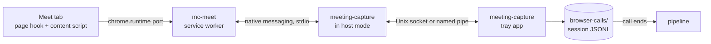

# mc-meet extension

mc-meet is our Chrome extension for Google Meet. It reads captions, chat and the participant
list in each call you join, and streams them to the tray app as they happen. The app writes one
note per call. It replaces TranscripTonic and the webhook receiver.

## Parts

| Part | Where | Job |
| --- | --- | --- |
| Page hook | `extension/page-hook.js` and `extension/page/wire.js`, MAIN world, `document_start` | Wraps `RTCPeerConnection` and decodes Meet's `collections`, `captions`, `captions_v2` and `meet_messages` data channels. Opens the two caption channels itself. |
| Content script | `extension/content/`, isolated world | Finds call start and end, reads the DOM when the channels give nothing, and owns the call session for its tab. |
| Service worker | `extension/background.js` | Holds the native port, numbers and queues events, resends after a reconnect. |
| Host mode | `crates/native-host`, run by the app binary | Chrome starts `meeting-capture chrome-extension://<id>/`. `main` sees the argument and relays frames between stdio and the app socket before Tauri starts. |
| Call log | `crates/app/src/browser_calls.rs` | Listens on the socket, appends each event to the session log, acks it, ends calls, hands logs to intake. |
| Parser | `crates/sources/src/browser_call.rs` | Turns a session log into a `Transcript`. |

## Identity

- Extension ID: `pbpjeihgfeefjehjnjknnefomhkblcfk`. The `key` in `extension/manifest.json` pins it.
  The private key is not needed to load unpacked.
- Native host name: `com.meetingcapture.app`. The manifest's `allowed_origins` lists only
  `chrome-extension://pbpjeihgfeefjehjnjknnefomhkblcfk/`.
- The app writes the host manifest on every start, with `path` set to its current executable.
  - macOS: `<browser config>/NativeMessagingHosts/com.meetingcapture.app.json` for each of
    Google Chrome, Chrome Beta, Chrome Canary, Chromium, Brave and Microsoft Edge whose config
    folder exists.
  - Windows: one manifest file in the app's data folder, and a
    `HKCU\Software\<browser>\NativeMessagingHosts\com.meetingcapture.app` key per browser pointing
    at it.

## Socket

- macOS: Unix socket `browser-calls.sock` in the app's data folder, mode 0600. The app removes a
  stale socket file at start.
- Windows: named pipe `\\.\pipe\meeting-capture-<user name>`, remote clients rejected.
- `MEETING_CAPTURE_HOME` moves the data folder for both the app and host mode, as it does for `mc`.
  On Windows it adds `-<8 hex digits>` from the data folder's SHA-256 to the pipe name.
- The app drops a connection whose first frame is not `host_hello` with the extension's origin.
- Host mode logs to `native-host.log` in the app's logs folder. Stdout carries only frames.
- One socket connection per extension port. The app serves several at once: one per Chrome
  profile.

## Frames

- Chrome to host and host to Chrome: Chrome's native messaging framing, a 32-bit length in native
  byte order, then UTF-8 JSON. A message to Chrome is at most 1 MB.
- Host to app and app to host: the same frames with a little-endian length. The host passes every
  frame through unchanged, except the first one it sends the app:
  `{"type":"host_hello","origin":"chrome-extension://.../","host_version":"0.2.0"}`.
- A frame over 1 MB from either side closes the connection.
- When the socket is absent, host mode starts the app and retries the connection every 250 ms for
  10 s. Then it sends `{"type":"app_unavailable"}` to Chrome and exits.

## Messages

Each message is a JSON object with a `type`. Times are RFC 3339 UTC strings. Unknown `type`s and
unknown fields are ignored on both sides, so either side can be newer.

### Extension to app

| `type` | Fields | When |
| --- | --- | --- |
| `hello` | `protocol` (integer, now 1), `extension_version` | First message on each port. |
| `event` | `seq`, `session_id`, `event` | Each call event. `seq` grows by one per event for the whole install and survives a worker restart. A new install starts it at the install time in microseconds, so a reinstall mid-call never repeats a `seq` in the session it resumes. |

`event.kind` is one of:

| `kind` | Fields |
| --- | --- |
| `call_started` | `at`, `platform` (`meet`), `meeting_code`, `title`, `tab_id` |
| `caption` | `at`, `device_id`, `utterance_id`, `version`, `speaker`, `text`, `source` (`channel` or `dom`) |
| `chat` | `at`, `message_id`, `device_id` (channel only), `sender`, `text`, `source` |
| `roster` | `at`, `participants`: list of `{device_id, name, is_self}`, the whole list each time it changes |
| `health` | `at`, `source` (`channel`, `dom` or `none`), `captions_on` (Meet's captions button is on), `parse_failures`, `detail` |
| `call_ended` | `at`, `reason` (`left`, `tab_closed`, `kicked`, `page_unload`; the app writes `idle` and `app_restarted`) |

- `caption`: `utterance_id` is a string and `version` an integer. `at` is when the utterance first
  appeared, so every version of one utterance has the same `at`. A `caption` with a higher
  `version` for the same `device_id` and `utterance_id` replaces the earlier text. The extension
  sends a new version only when the version grows or the text changes.
- `speaker` is empty when the device had no name yet. The app then takes the name for
  `device_id` from the roster. `sender` on `chat` follows the same rule.
- The DOM source has no device or utterance IDs. It uses the speaker name as `device_id`, and
  `dom-<page token>-<turn number>` as `utterance_id`. The page token keeps IDs unique after a
  reload.
- Channel `device_id`s look like `spaces/<id>/devices/<id>`. Legacy `captions` frames get a `v1-`
  prefix on `utterance_id`. They are dropped once a `captions_v2` frame has arrived.
- `roster` lists the people in the call now: devices with status left (6), removed (7) or refused
  (4) are dropped, and so are screen-share devices. The app unions every roster of the session.
- `health` is sent at call start and whenever one of its fields changes. `detail` is null, or the
  reason for the DOM fallback, or a parse-gap report: after 10 failed frames in a row on one
  channel, it names the failure reasons and a skeleton of the last frame (tag and wire type tree
  with lengths, no text). `parse_failures` counts failed frames on all channels.

### App to extension

| `type` | Fields | When |
| --- | --- | --- |
| `welcome` | `protocol`, `app_version`, `open_sessions` (session IDs the app still has open) | Reply to `hello`. |
| `ack` | `seq` | After the event is appended to its log. |
| `app_unavailable` | none | From host mode when the app did not start in 10 s. |

The extension keeps each event in `chrome.storage.local` until its `ack`, and resends unacked
events in `seq` order after `welcome`. The app ignores an event whose `seq` its log already has,
and acks it again. An event with an invalid `session_id` (1 to 64 letters, digits or hyphens) or
invalid fields for its `kind` is acked and dropped, since a resend cannot fix it. An event the app
could not write gets no `ack`.

## Sessions

- A session is one call in one tab. The content script creates `session_id` (a UUID) when the
  call starts, and keeps it in `sessionStorage` with the meeting code. A reload of the same
  meeting in the same tab within 5 minutes reuses the session. A second Meet tab never touches
  the first tab's session.
- The page is in a call when the Leave call button exists. The content script ends the call when
  that button is gone for 3 s: `kicked` if the roster showed the local device as removed, else
  `left`.
- The worker ends the call `tab_closed` when the tab closes.
- When the page unloads (reload, navigation, crash), the worker waits 5 minutes. If the same tab
  resumes the session, the call goes on. Otherwise the worker ends it `page_unload`, with `at` set
  to the unload time. A new session in that tab ends the old one at once.
- When the worker starts and a session's tab no longer exists, the session gets the same 5-minute
  wait. This covers a browser restart or crash, and a session left open while the extension was
  off.
- The worker sets the tab to `autoDiscardable: false` while the call runs.

## Extension internals

- Caption source. The hook opens `captions` and `captions_v2` on the peer connection that carries
  `collections`. Meet sends nothing on them until its captions are on, so the content script
  clicks the captions button when the call starts if captions are off, at most 3 times per caption
  source. When no caption arrives within 20 s of opening the channels, or 10 caption frames in a
  row fail to decode with no good caption in the last 20 s, the content script reads the caption
  region in the DOM. The first channel caption after that switches back to the channel and stops
  the DOM reader.
- Roster. From `collections` and the `SyncMeetingSpaceCollections` response. When neither gives a
  roster 30 s into the call, the content script reads the People panel if it is open, else the
  video tiles, every 10 s.
- Chat. From `collections`, `meet_messages` and the `CreateMeetingMessage` response, deduplicated
  by message name. There is no DOM chat reader.
- Content script to worker. One port per tab. Each event carries a number `n` per session, kept in
  `sessionStorage`. The worker stores the event, replies `stored`, and drops any `n` it has stored
  before. The content script resends unstored events after a reconnect. It pings every 20 s. If
  the worker already ended the session (the page came back after 5 minutes), it replies
  `session_ended`, and the content script starts a new session.
- Worker to app. The worker opens the native port when it has a call or queued events, and closes
  it after the ack of the last `call_ended`. On a disconnect or `app_unavailable` it reconnects
  after 1 s, doubling to 60 s, and an alarm retries every 30 s.
- Extension update. The worker injects fresh content scripts into open Meet tabs. They resume the
  tab's session. The old page hook keeps running until the tab reloads.
- Permissions: `nativeMessaging`, `storage`, `unlimitedStorage` (a long call queued while the app
  is down), `alarms`, `scripting` (the update injection), host `https://meet.google.com/*`.

## App rules

- Log: `browser-calls/<started_at>-<session_id>.jsonl` in the data folder, `started_at` as
  `20261019T115918.000Z`. Each line is `{"seq":..,"received_at":..,"event":{..}}`, appended and
  flushed before the `ack`. The event is stored as received, unknown fields included.
- The call ends on `call_ended`, or 5 minutes after the last event once no port has the session
  open. Then intake reads the log as `InputKind::BrowserCallLog`. For the second case the app
  appends its own `call_ended` line, with reason `idle` and no `seq`.
- A new session joins the log of an earlier call when its `call_started` has the same meeting
  code, and that call is open or its last event is at most 10 minutes before. This covers
  leaving and joining again, and joining from a new tab after a crash. The note stays one note.
  - A `<session_id>.rejoin` file next to the logs names the log the session joined, so resends
    and a restart find it.
  - The call ends when its last session ends.
  - Two different meetings on one meeting code, such as a personal room, merge when the second
    starts within 10 minutes of the first.
- An event for a session whose log already ended reopens that log. The call ends again by the
  same rules, and intake updates the same meeting and note.
- A call with fewer than 3 caption lines writes no note, as for huddles. The log stays.
- At start, the app closes each log with no end line from a previous run and takes it in. The
  end line is a `call_ended` with reason `app_restarted` and no `seq`, at the time of the last
  event.
- Attendees are every participant in any `roster` event, the local user included. Speakers and
  chat senders join the list when no roster arrived.
- The tray shows: extension connected or not, the current call, the caption source (channel or
  DOM), and the last health problem.

## Install

1. Open `chrome://extensions`. Turn on Developer mode.
2. Click "Load unpacked". Pick the repo's `extension/` folder.
3. Start the app once, so it writes the native host manifest.

After a pull, click the reload icon on mc-meet in `chrome://extensions`. The tray warns when the
extension's protocol is older than the app's.

### Dev runs on macOS

- Run a dev app from outside `~/Documents`. Privacy controls stop Chrome from starting a host
  there, and Chrome reports only "Native host has exited".
- Chrome reads host manifests from its default config folder, even when started with a custom
  `--user-data-dir`. A dev app overwrites the installed app's manifest there.
- An extension loaded through CDP `Extensions.loadUnpacked` is gone after a browser restart. Its
  storage stays.
- A fake microphone built on an `AudioContext` starts suspended. Resume it from a user gesture,
  or the call gets no speech and no captions.
- The tray shows mc-meet as connected only while the worker has work, since the port closes
  after the last ack.

## Sources

- DOM readers: TranscripTonic, MIT, <https://github.com/vivek-nexus/transcriptonic>, commit
  `0cb5eb5667759cd9cd0bb98d1ce6bdb763a30151`. The licence is in `extension/content/LICENSE-transcriptonic`.
- Host relay: Anarlog's `crates/chrome-native-host`, MIT, <https://github.com/fastrepl/anarlog>,
  commit `6fd155aa1af39ef652b767133caccb280de750f6`.
- Data channel layout: our own decoder. Field numbers and their sources are in
  `extension/PROTOCOL-NOTES.md`. Research notes in
  `~/knowledge/areas/infrastructure/meeting-recording/local-capture/how-tools-work/`.
