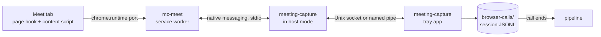

# mc-meet extension

mc-meet is our Chrome extension for Google Meet. It reads captions, chat and the participant
list in each call you join, and streams them to the tray app as they happen. The app writes one
note per call. It replaces TranscripTonic and the webhook receiver.

## Parts

| Part | Where | Job |
| --- | --- | --- |
| Page hook | `extension/page-hook.js`, MAIN world, `document_start` | Wraps `RTCPeerConnection` and decodes Meet's `collections`, `captions`, `captions_v2` and `meet_messages` data channels. |
| Content script | `extension/content/`, isolated world | Finds call start and end, reads the DOM when the channels give nothing, and owns the call session for its tab. |
| Service worker | `extension/background.js` | Holds the native port, numbers and queues events, resends after a reconnect. |
| Host mode | `crates/native-host`, run by the app binary | Chrome starts `meeting-capture chrome-extension://<id>/`. `main` sees the argument and relays frames between stdio and the app socket before Tauri starts. |
| Call log | `crates/app/src/browser_calls.rs` | Listens on the socket, appends each event to the session log, acks it, ends calls, hands logs to intake. |
| Parser | `crates/sources/src/browser_call.rs` | Turns a session log into a `Transcript`. |

## Identity

- Extension ID: `pbpjeihgfeefjehjnjknnefomhkblcfk`. The `key` in `extension/manifest.json` pins it.
  The private key is not needed to load unpacked.
- Native host name: `com.meetingcapture.app`. The manifest's `allowed_origins` lists only
  `chrome-extension://pbpjeihgfeefjehjnjknnefomhkblcfk/`.
- The app writes the host manifest on every start, with `path` set to its current executable.
  - macOS: `<browser config>/NativeMessagingHosts/com.meetingcapture.app.json` for each of
    Google Chrome, Chrome Beta, Chrome Canary, Chromium, Brave and Microsoft Edge whose config
    folder exists.
  - Windows: one manifest file in the app's data folder, and a
    `HKCU\Software\<browser>\NativeMessagingHosts\com.meetingcapture.app` key per browser pointing
    at it.

## Socket

- macOS: Unix socket `browser-calls.sock` in the app's data folder, mode 0600. The app removes a
  stale socket file at start.
- Windows: named pipe `\\.\pipe\meeting-capture-<user name>`, remote clients rejected.
- `MEETING_CAPTURE_HOME` moves the data folder for both the app and host mode, as it does for `mc`.
- One socket connection per extension port. The app serves several at once: one per Chrome
  profile.

## Frames

- Chrome to host and host to Chrome: Chrome's native messaging framing, a 32-bit length in native
  byte order, then UTF-8 JSON. A message to Chrome is at most 1 MB.
- Host to app and app to host: the same frames with a little-endian length. The host passes every
  frame through unchanged, except the first one it sends the app:
  `{"type":"host_hello","origin":"chrome-extension://.../","host_version":"0.2.0"}`.
- A frame over 1 MB from either side closes the connection.
- When the socket is absent, host mode starts the app and retries the connection every 250 ms for
  10 s. Then it sends `{"type":"app_unavailable"}` to Chrome and exits.

## Messages

Each message is a JSON object with a `type`. Times are RFC 3339 UTC strings. Unknown `type`s and
unknown fields are ignored on both sides, so either side can be newer.

### Extension to app

| `type` | Fields | When |
| --- | --- | --- |
| `hello` | `protocol` (integer, now 1), `extension_version` | First message on each port. |
| `event` | `seq`, `session_id`, `event` | Each call event. `seq` grows by one per event for the whole install and survives a worker restart. |

`event.kind` is one of:

| `kind` | Fields |
| --- | --- |
| `call_started` | `at`, `platform` (`meet`), `meeting_code`, `title`, `tab_id` |
| `caption` | `at`, `device_id`, `utterance_id`, `version`, `speaker`, `text`, `source` (`channel` or `dom`) |
| `chat` | `at`, `message_id`, `sender`, `text`, `source` |
| `roster` | `at`, `participants`: list of `{device_id, name, is_self}`, the whole list each time it changes |
| `health` | `at`, `source` (`channel`, `dom` or `none`), `captions_on`, `parse_failures`, `detail` |
| `call_ended` | `at`, `reason` (`left`, `tab_closed`, `kicked`, `page_unload`) |

A `caption` with a higher `version` for the same `device_id` and `utterance_id` replaces the earlier
text. The DOM source has no device or utterance IDs: it uses the speaker name as `device_id` and
a counter per speaker turn as `utterance_id`.

### App to extension

| `type` | Fields | When |
| --- | --- | --- |
| `welcome` | `protocol`, `app_version`, `open_sessions` (session IDs the app still has open) | Reply to `hello`. |
| `ack` | `seq` | After the event is appended to its log. |
| `app_unavailable` | none | From host mode when the app did not start in 10 s. |

The extension keeps each event in `chrome.storage.local` until its `ack`, and resends unacked
events in `seq` order after `welcome`. The app ignores an event whose `seq` its log already has,
and acks it again.

## Sessions

- A session is one call in one tab. The content script creates `session_id` (a UUID) when the
  call starts, and keeps it in `sessionStorage` with the meeting code. A reload of the same
  meeting in the same tab within 5 minutes reuses the session. A second Meet tab never touches
  the first tab's session.
- The page is in a call when the Leave call button exists. The call ends when that button is gone
  for 3 s, on tab close, or on page unload.
- The content script sets the tab to `autoDiscardable: false` through the worker while the call
  runs.

## App rules

- Log: `browser-calls/<started_at>-<session_id>.jsonl` in the data folder. Each line is
  `{"seq":..,"received_at":..,"event":{..}}`, appended and flushed before the `ack`.
- The call ends on `call_ended`, or 5 minutes after the last event once no port has the session
  open. Then intake reads the log as `InputKind::BrowserCallLog`.
- A call with fewer than 3 caption lines writes no note, as for huddles. The log stays.
- At start, the app closes each log with no end line from a previous run and takes it in.
- Attendees are every participant in any `roster` event, the local user included. Speakers and
  chat senders join the list when no roster arrived.
- The tray shows: extension connected or not, the current call, the caption source (channel or
  DOM), and the last health problem.

## Install

1. Open `chrome://extensions`. Turn on Developer mode.
2. Click "Load unpacked". Pick the repo's `extension/` folder.
3. Start the app once, so it writes the native host manifest.

After a pull, click the reload icon on mc-meet in `chrome://extensions`. The tray warns when the
extension's protocol is older than the app's.

## Sources

- DOM readers: TranscripTonic, MIT, <https://github.com/vivek-nexus/transcriptonic>, commit
  `0cb5eb5667759cd9cd0bb98d1ce6bdb763a30151`. The licence is in `extension/content/LICENSE-transcriptonic`.
- Host relay: Anarlog's `crates/chrome-native-host`, MIT, <https://github.com/fastrepl/anarlog>,
  commit `6fd155aa1af39ef652b767133caccb280de750f6`.
- Data channel layout: our own decoder. Research notes in
  `~/knowledge/areas/infrastructure/meeting-recording/local-capture/how-tools-work/`.
