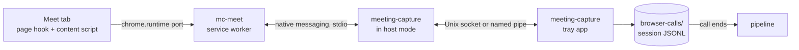

# mc-meet extension

mc-meet is our Chrome extension for Google Meet. It reads captions, chat and the participant
list in each call you join, and streams them to the tray app as they happen. The app writes one
note per call.

## Parts

| Part | Where | Job |
| --- | --- | --- |
| Call events | `extension/call-events.js`, isolated world and service worker | Builds every event the extension sends, one function per `kind`, in the shapes below. |
| Page hook | `extension/page-hook.js` and `extension/page/wire.js`, MAIN world, `document_start` | Wraps `RTCPeerConnection` and decodes Meet's `collections`, `captions`, `captions_v2` and `meet_messages` data channels. Opens the two caption channels itself. |
| Content script | `extension/content/`, isolated world | Finds call start and end, reads the DOM when the channels give nothing, and owns the call session for its tab. |
| Session rules | `extension/session-rules.js`, service worker | Decides what each tab message, tab change and alarm does to the worker's sessions. Numbers events. Makes no `chrome.*` calls and reads no clock, so it also runs in Node. |
| Service worker | `extension/background.js` | Stores the session state and queued events in one write, holds the native port, resends after a reconnect. Shows each Meet tab's call status on the toolbar icon. |
| Popup | `extension/popup/` | The active tab's call status, and a "Save debug report" button. |
| Host mode | `crates/native-host`, run by the app binary | Chrome starts `meeting-capture chrome-extension://<id>/`. `main` sees the argument and relays frames between stdio and the app socket before Tauri starts. |
| Call log | `crates/app/src/browser_calls.rs` | Listens on the socket, appends each event to the session log, acks it, ends calls, hands logs to intake. |
| Parser | `crates/sources/src/browser_call.rs` | Turns a session log into a `Transcript`. |

## Identity

- Extension ID: `pbpjeihgfeefjehjnjknnefomhkblcfk`. The `key` in `extension/manifest.json` pins it.
  The private key is not needed to load unpacked.
- Native host name: `com.meetingcapture.app`. The manifest's `allowed_origins` lists only
  `chrome-extension://pbpjeihgfeefjehjnjknnefomhkblcfk/`.
- The app writes the host manifest on every start, with `path` set to its current executable.
  - macOS: `<browser config>/NativeMessagingHosts/com.meetingcapture.app.json` for each of
    Google Chrome, Chrome Beta, Chrome Canary, Chromium, Brave and Microsoft Edge whose config
    folder exists.
  - Windows: one manifest file in the app's data folder, and a
    `HKCU\Software\<browser>\NativeMessagingHosts\com.meetingcapture.app` key per browser pointing
    at it.

## Socket

- macOS: Unix socket `browser-calls.sock` in the app's data folder, mode 0600. The app removes a
  stale socket file at start.
- Windows: named pipe `\\.\pipe\meeting-capture-<user name>`, remote clients rejected.
- `MEETING_CAPTURE_HOME` moves the data folder for both the app and host mode, as it does for `mc`.
  On Windows it adds `-<8 hex digits>` from the data folder's SHA-256 to the pipe name.
- The app drops a connection whose first frame is not `host_hello` with the extension's origin.
- Host mode logs to `native-host.log` in the app's logs folder. Stdout carries only frames.
- One socket connection per extension port. The app serves several at once: one per Chrome
  profile.

## Frames

- Chrome to host and host to Chrome: Chrome's native messaging framing, a 32-bit length in native
  byte order, then UTF-8 JSON. A message to Chrome is at most 1 MB.
- Host to app and app to host: the same frames with a little-endian length. The host passes every
  frame through unchanged, except the first one it sends the app:
  `{"type":"host_hello","origin":"chrome-extension://.../","host_version":"0.2.0"}`.
- A frame over 1 MB from either side closes the connection.
- When the socket is absent, host mode starts the app and retries the connection every 250 ms for
  10 s. Then it sends `{"type":"app_unavailable"}` to Chrome and exits.

## Messages

Each message is a JSON object with a `type`. Times are RFC 3339 UTC strings. Unknown `type`s and
unknown fields are ignored on both sides, so either side can be newer.

### Extension to app

| `type` | Fields | When |
| --- | --- | --- |
| `hello` | `protocol` (integer, now 1), `extension_version`, `sessions` (the session IDs the worker has open) | First message on each port. The app counts the port as the holder of those calls. |
| `event` | `seq`, `session_id`, `event` | Each call event. `seq` grows by one per event for the whole install and survives a worker restart. A new install starts it at the install time in microseconds, so a reinstall mid-call never repeats a `seq` in the session it resumes. |
| `frame_failed` | `session_id`, `channel` (`captions` or `captions_v2`), `at`, `reason`, `skeleton`, `byte_length`, `bytes_base64` (the frame as received, or null above 256 KB) | A caption channel frame that did not decode. At most 20 per channel per call from the page, and 20 per session from the content script. Failures on `collections` and `meet_messages` stay in the page: a chat or roster frame with nothing to read is common. Not queued: sent only while the app is connected. |
| `pages_away` | `session_ids`: every session whose tab closed, reloaded or crashed and may still come back | After `welcome`, and whenever the list changes. Not queued. A call all of whose sessions are away shows "the Meet tab closed or reloaded", with no notification. |
| `page_snapshot` | `session_id`, `snapshot` | Reply to `snapshot_request`. See "Debug material". |
| `save_debug_report` | `session_id` (the popup's tab session, or null), `with_text` | The popup's "Save debug report" button. The app answers `debug_report_failed` for a `session_id` that is not 1 to 64 letters, digits or hyphens. |

`event.kind` is one of the kinds below. `extension/call-events.js` builds each of them.

| `kind` | Fields |
| --- | --- |
| `call_started` | `at`, `platform` (`meet`), `meeting_code`, `title`, `tab_id` |
| `caption` | `at`, `device_id`, `utterance_id`, `version`, `speaker`, `text`, `source` (`channel` or `dom`) |
| `chat` | `at`, `message_id`, `device_id` (channel only), `sender`, `text`, `source` |
| `roster` | `at`, `participants`: list of `{device_id, name, is_self}`, the whole list each time it changes |
| `health` | `at`, `source` (`channel`, `dom` or `none`), `captions_on` (Meet's captions button is on, and Meet does not refuse captions), `captions_unavailable` (Meet refuses captions), `caption_frames_failing` (caption frames fail to decode, with no caption decoded since), `parse_failures`, `detail` |
| `call_ended` | `at`, `reason` (`left`, `tab_closed`, `kicked`, `page_unload`; the app writes `idle` and `app_restarted`) |

- `caption`: `utterance_id` is a string and `version` an integer. `at` is when the utterance first
  appeared, so every version of one utterance has the same `at`. A `caption` with a higher
  `version` for the same `device_id` and `utterance_id` replaces the earlier text. The extension
  sends a new version only when the version grows or the text changes.
- `speaker` is empty when the device had no name yet. The parser then takes the name for
  `device_id` from the attendee list, which holds the first name any `roster` in the log gave
  that device. A roster that arrives late still names the earlier lines. `sender` on `chat`
  follows the same rule. A `chat` with no `device_id` keeps an empty `sender`.
- The DOM source has no device or utterance IDs. It uses the speaker name as `device_id`, and
  `dom-<page token>-<turn number>` as `utterance_id`. The page token keeps IDs unique after a
  reload.
- Channel `device_id`s look like `spaces/<id>/devices/<id>`. Legacy `captions` frames get a `v1-`
  prefix on `utterance_id`. They are dropped once a `captions_v2` frame has arrived.
- `roster` lists the people in the call now: devices with status left (6), removed (7) or refused
  (4) are dropped, and so are screen-share devices. The app unions every roster of the session.
- `health` is sent at call start and whenever one of its fields changes. `detail` is null, or the
  reason for the DOM fallback, or a parse-gap report: after 10 failed frames in a row on one
  channel, it names the failure reasons and a skeleton of the last frame (tag and wire type tree
  with lengths, no text). `parse_failures` counts failed frames on all channels.
- `captions_unavailable` is true when Meet's captions button is disabled, or its own label says
  "Live captions are temporarily unavailable". A hover tooltip with that text does not count: it
  shows only under the pointer. The text match is English only; other UI languages rely on the
  disabled button.
- `source` is `channel` only after a caption arrived on the caption channels the page has open.
  When Meet opens a new meeting connection, the hook opens new caption channels and `source`
  goes back to `none` until one of them carries a caption.
- After each `welcome` the worker tells every Meet tab, and each tab sends `health` again: a
  restarted app has none for the call.

### App to extension

| `type` | Fields | When |
| --- | --- | --- |
| `welcome` | `protocol`, `app_version`, `folder_version` (the version in the folder the app installs mc-meet into, or null), `open_sessions` (session IDs the app still has open), `settings` | Reply to `hello`. |
| `ack` | `seq` | After the event is appended to its log. |
| `settings` | `settings` | After a save in the settings window, to every welcomed port. |
| `app_unavailable` | none | From host mode when the app did not start in 10 s. |
| `call_status` | `calls`: one entry per open Meet call, below | After `welcome`, and whenever a call's status changes. |
| `snapshot_request` | `session_ids` | When a call gets a problem, at most 5 times per call. |
| `debug_report_saved` | `path` | Reply to `save_debug_report`. |
| `debug_report_failed` | `error` | Reply to `save_debug_report`. |

Each `call_status` entry has `session_ids`, `title`, `state` (`waiting`, `recording` or
`problem`), `reason` and `reason_text` (null unless `problem`), `started_at`, `started_at_label`,
`recording_since_label`, `caption_count`, `last_caption_at`, `caption_source` (`channel`, `dom`,
`none` or null), and `problems` (the last 3, oldest first, each `{reason, reason_text, at,
at_label}`). Labels are clock times such as `21:02 IST` in the app's settings time zone.
`reason` is one of `captions_off`, `meet_captions_unavailable`, `caption_parse_failures`,
`captions_silent`, `no_captions`, `extension_disconnected`, `meet_page_away` and
`huddle_captions_unreadable`. mc-meet shows `reason_text` and needs no other.

The extension keeps each event in `chrome.storage.local` until its `ack`, and resends unacked
events in `seq` order after `welcome`. The app ignores an event whose `seq` its log already has,
and acks it again. An event with an invalid `session_id` (1 to 64 letters, digits or hyphens) or
invalid fields for its `kind` is acked and dropped, since a resend cannot fix it. An event the app
could not write gets no `ack`.

`settings` holds `hide_captions`, the app's `[meet] hide_captions`. The worker stores it in
`chrome.storage.local`, and the content script reads it at load and on each change. Without a
stored value the content script hides captions.

## Sessions

- A session is one call in one tab. The content script creates `session_id` (a UUID) when the
  call starts, and keeps it in `sessionStorage` with the meeting code. A reload of the same
  meeting in the same tab within 5 minutes reuses the session. A second Meet tab never touches
  the first tab's session.
- The page is in a call when the Leave call button exists. The content script ends the call when
  that button is gone for 3 s: `kicked` if the roster showed the local device as removed, else
  `left`.
- The worker ends the call `tab_closed` when the tab closes.
- When the page unloads (reload, navigation, crash), the worker waits 5 minutes. If the same tab
  resumes the session, the call goes on. Otherwise the worker ends it `page_unload`, with `at` set
  to the unload time. A new session in that tab ends the old one at once.
- When the worker starts and a session's tab no longer exists, the session gets the same 5-minute
  wait. This covers a browser restart or crash, and a session left open while the extension was
  off.
- The worker sets the tab to `autoDiscardable: false` while the call runs.

## Extension internals

- Caption source. The hook opens `captions` and `captions_v2` on the peer connection that carries
  `collections`. Meet sends nothing on them until its captions are on, so the content script
  clicks the captions button when the call starts if captions are off, at most 3 times per caption
  source. When no caption arrives within 20 s of opening the channels, or 10 caption frames in a
  row fail to decode with no good caption in the last 20 s, the content script reads the caption
  region in the DOM. The first channel caption after that switches back to the channel and stops
  the DOM reader. `extension/content/caption-source.js` holds these rules. It reads no DOM and no
  clock, so it also runs in Node. `content/main.js` feeds it timestamped facts and runs the reader
  it picks.
- Hidden captions. Meet's caption box covers a shared screen. With `hide_captions` on, the
  content script turns Meet's captions off after the first channel caption, so the box shows for
  a few seconds at call start. Turning captions off makes Meet close its own caption channel and
  stop streaming captions. The page hook blocks `close()` on caption channels it did not open,
  and Meet keeps streaming to the hook's channels. Once hidden, the content script never turns
  captions back on in that call, so a user who wants them can. A new peer connection turns them on
  again until its channels carry a caption. While the DOM reader runs, captions stay on and the
  caption region gets `display: none`. Meet keeps writing captions into the hidden region.
- The DOM reader makes one utterance of each speaker turn. Meet did not trim a 1200-character
  monologue in the caption region, so one speaker talking alone gives one caption line, and a call
  with fewer than 3 lines writes no note.
- Page hook to content script. The hook sends spec events (`caption`, `chat`, `roster`) as
  `event` messages. It sends its own notices (`parse_gap`, `self_removed`, `frame_failed`) as
  `notice` messages. Only `frame_failed` of a caption channel reaches the app, as `frame_failed`.
- Roster. From `collections` and the `SyncMeetingSpaceCollections` response. When neither gives a
  roster 30 s into the call, the content script reads the People panel if it is open, else the
  video tiles, every 10 s.
- Chat. From `collections`, `meet_messages` and the `CreateMeetingMessage` response, deduplicated
  by message name. There is no DOM chat reader.
- Content script to worker. One port per tab. Each event carries a number `n` per session, kept in
  `sessionStorage`. The worker stores the event, replies `stored`, and drops any `n` it has stored
  before. The content script resends unstored events after a reconnect. It pings every 20 s. If
  the worker already ended the session (the page came back after 5 minutes), it replies
  `session_ended`, and the content script starts a new session.
- Worker to app. The worker opens the native port when it has a call or queued events, and closes
  it after the ack of the last `call_ended`. On a disconnect or `app_unavailable` it reconnects
  after 1 s, doubling to 60 s, and an alarm retries every 30 s.
- Extension update. The worker injects fresh content scripts into open Meet tabs. They resume the
  tab's session. The old page hook keeps running until the tab reloads.
- Permissions: `nativeMessaging`, `storage`, `unlimitedStorage` (a long call queued while the app
  is down), `alarms`, `scripting` (the update injection), `notifications` (the app is not
  running), host `https://meet.google.com/*`.

## Call status

The app decides each call's status. mc-meet only shows it, and decides one thing itself: that the
app is not reachable.

| State | Icon | Badge | Title |
| --- | --- | --- | --- |
| No call in the tab | grey ring | none | `mc-meet: connected` |
| Waiting | grey ring | `…` | `Waiting for captions` |
| Recording | red dot | `REC` | `Recording since 21:02 IST` |
| Problem | amber | `!` | `Not recording: <reason>` |
| App not reachable | grey ring, crossed out | `OFF` | `Meeting Capture is not running` |

- The worker sets the icon, badge and title per Meet tab with `chrome.action`. It keeps the last
  `call_status` and the app's reachability in `chrome.storage.session`, which the popup reads.
- The app is not reachable after `app_unavailable`, a failed `connectNative`, or a native port
  that closed before `welcome`. With a call open, the worker then shows one Chrome notification
  per outage.
- The popup shows the state and reason, the title, start time, caption count, the time since the
  last caption, the caption source (`call` for the channels, `page` for the DOM), the app and
  mc-meet versions, and the last 3 problems. An open popup keeps the native port open. Opening
  it with no call starts the app if it is not running, since host mode starts the app.
- "Save debug report" in the popup sends `save_debug_report` with the tab's session. The app
  writes the report and reveals it in Finder or Explorer. With no answer in 30 s, the popup says
  the report was not saved.

## Debug material

The app keeps debug material per call in `debug/<call>/` in the data folder. Raw frames hold call
speech, so it never leaves the data folder unless the user saves a report. The app deletes debug
folders after 14 days.

| File | What |
| --- | --- |
| `frames.jsonl` | The first 20 `frame_failed` messages of the call, one per line, bytes included. |
| `lead-up.jsonl` | The last 2 minutes of mc-meet events before the call's first problem, written once. Kept in memory until then. |
| `page-snapshots.jsonl` | Up to 5 page snapshots per call, one per problem. |

A page snapshot holds the captions button state and the last "captions unavailable" text Meet
showed on it, the caption source policy's health, the caption region's element tree with each
text replaced by its length, the last 30 data channels the hook saw with their state, the frame
counters per channel, Meet's build label when the page exposes it, the Chrome version and the
mc-meet version. It holds no caption text.

"Save debug report" (tray, or popup) writes `debug-reports/<time>-<call>/` in the data folder:
`call-status.json`, the `app.log` lines that name the call, the call's session logs and its debug
files. By default the report keeps only strings under keys known to hold times, ids, versions and
codes. Every other string becomes `[N chars]`: caption and chat text, speaker, sender and
participant names, meeting titles and codes, Slack channels, workspaces and window titles, error
messages and `detail`. Device and message IDs become `device-N` and `message-N`, the same number
for the same ID across the report, since the DOM reader uses a speaker's name as the device ID.
Frame bytes are dropped. "Save debug report with caption text" keeps everything.

`just replay-frames <path>` runs the frames of a report folder, a call's debug folder or a
`frames.jsonl` through `extension/page/wire.js` in Node, and prints what each frame decodes to
now. A report without caption text has no bytes to replay.

## App rules

- Log: `browser-calls/<started_at>-<session_id>.jsonl` in the data folder, `started_at` as
  `20261019T115918.000Z`. Each line is `{"seq":..,"received_at":..,"event":{..}}`, appended and
  flushed before the `ack`. The event is stored as received, unknown fields included.
- The call ends on `call_ended`, or 5 minutes after the last event once no port has the session
  open. Then intake reads the log as `InputKind::BrowserCallLog`. For the second case the app
  appends its own `call_ended` line, with reason `idle` and no `seq`.
- A new session joins the log of an earlier call when its `call_started` has the same meeting
  code, and that call is open or its last event is at most 10 minutes before. This covers
  leaving and joining again, and joining from a new tab after a crash. The note stays one note.
  - A `<session_id>.rejoin` file next to the logs names the log the session joined, so resends
    and a restart find it.
  - The call ends when its last session ends.
  - Two different meetings on one meeting code, such as a personal room, merge when the second
    starts within 10 minutes of the first.
- An event for a session whose log already ended reopens that log. The call ends again by the
  same rules, and intake updates the same meeting and note.
- A call with fewer than 3 caption lines writes no note, as for huddles. The log stays.
- At start, the app closes each log with no end line from a previous run and takes it in. The
  end line is a `call_ended` with reason `app_restarted` and no `seq`, at the time of the last
  event.
- Attendees are every participant in any `roster` event, the local user included. Speakers and
  chat senders join the list when no roster arrived.
- The tray shows whether mc-meet is connected, and one status line per open call. See
  `docs/02-architecture.md`, "Call status".

## Install

Chrome installs extensions from outside the Chrome Web Store only as an unpacked folder. The app
bundles mc-meet and keeps that folder for you:

- macOS: `~/Library/Application Support/com.ujjwalkumar.meetingcapture/mc-meet`
- Windows: `%APPDATA%\ujjwalkumar\meetingcapture\data\mc-meet`

At each start, the app checks the folder's manifest version. When it differs from the app's
version, the app copies its bundled extension there, stamped with its own version, and leaves out
the docs. The tray item below always copies it again, which repairs a folder with missing files.

To install:

1. In the tray, pick "Install mc-meet in Chrome…". The app shows the folder in Finder or Explorer
   and opens `chrome://extensions` in Chrome.
2. Turn on Developer mode.
3. Drag the `mc-meet` folder onto the page, or click "Load unpacked" and pick it.
4. Pin mc-meet from the extensions menu in the toolbar, so its call status stays in view.

For Brave, Edge or another Chromium browser, open its extensions page and load the same folder.

Updates need no steps. In `welcome`, the app sends the folder's version as `folder_version`. When
that differs from the extension's version, the worker waits until the last call ends and its port
closes, then calls `chrome.runtime.reload()`, so Chrome reads the new files. It reloads once per
folder version and stores that version in `reloaded_for`. A folder the app does not manage
therefore reloads once, not after every call.

From a clone, load the repo's `extension/` folder instead, and click its reload icon after a pull.

### Dev runs on macOS

- Run a dev app from outside `~/Documents`. Privacy controls stop Chrome from starting a host
  there, and Chrome reports only "Native host has exited".
- Chrome reads host manifests from its default config folder, even when started with a custom
  `--user-data-dir`. A dev app overwrites the installed app's manifest there.
- An extension loaded through CDP `Extensions.loadUnpacked` is gone after a browser restart. Its
  storage stays.
- A fake microphone built on an `AudioContext` starts suspended. Resume it from a user gesture,
  or the call gets no speech and no captions.
- The tray shows mc-meet as connected only while the worker has work, since the port closes
  after the last ack.
- A worker with queued events starts the app through host mode, and that app points the host
  manifests at itself. Uninstall the extension before stopping a dev app, or a later call reaches
  the dev build.

## Sources

- DOM readers: TranscripTonic, MIT, <https://github.com/vivek-nexus/transcriptonic>, commit
  `0cb5eb5667759cd9cd0bb98d1ce6bdb763a30151`. The licence is in `extension/content/LICENSE-transcriptonic`.
- Host relay: Anarlog's `crates/chrome-native-host`, MIT, <https://github.com/fastrepl/anarlog>,
  commit `6fd155aa1af39ef652b767133caccb280de750f6`.
- Data channel layout: our own decoder. Field numbers and their sources are in
  `extension/PROTOCOL-NOTES.md`.
